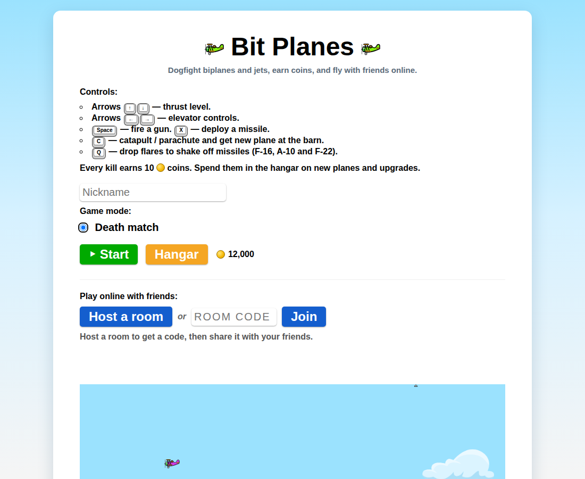
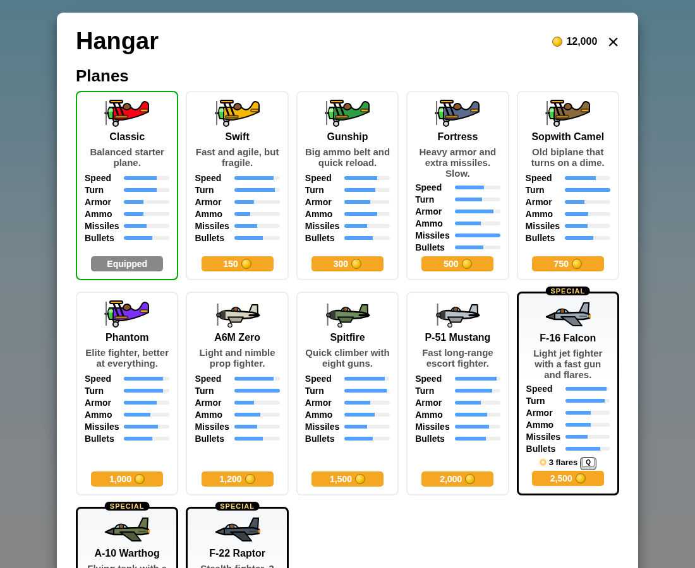
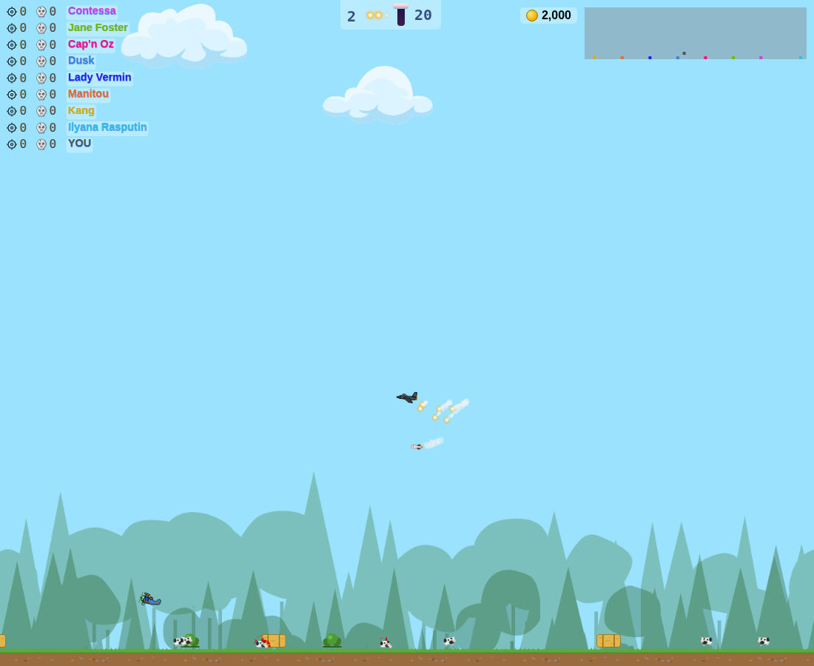

# ✈️ Bit Planes

A small browser dogfighting activity. Fly biplanes, WWII fighters and jets, shoot
down computer pilots, earn coins, upgrade your plane and play with friends
online using a room code.



## Play

Open `index.html` through any static web server and press **Start**:

```sh
python3 -m http.server 8000
# then open http://localhost:8000
```

It also works on GitHub Pages as is. There is no build step.

### The lobby

The start screen is a lobby, with the bots dogfighting behind it:

- **Top bar:** Play · **Stats** · **Hangar** (planes, paint, upgrades) ·
  **Skins** (pilot characters) · **Quests** (3 daily and 3 weekly quests with
  coin and XP rewards; a yellow dot means one is ready to claim) ·
  **Achievements** · **Leaderboard** (worldwide top 50).
- **Top right:** your level and XP bar, your coins (1.5K, 100K, 2.5M…) and
  your pilot's face.
- **Middle:** your pilot on the pad. Click your name above them to change it.
  The chip under the pad shows your plane (click for the Hangar).
- **Bottom left:** the mode (Death match or Multiplayer; click to switch) and
  **PLAY**. "Play with friends" hosts or joins a private room with a code.
- **Bottom right:** **👥 Friends**, **⚙ Settings**, **Controls** and
  **Servers** (Multiplayer server browser).

While flying, a timer sits in the bottom left: the match countdown in
Multiplayer, your time in the air otherwise.

**Skins:** 11 pilots from Common to Legendary: Rookie (free), Ace, Red Baron,
Night Owl, Arctic Fox, Desert Hawk, Moo Pilot, Top Gun, Neon Rider, Stealth
and Golden Ace (25,000 coins).

### One-line version (loads from GitHub)

`play.html` is a single line that runs the newest activity from this GitHub repo
through the [jsDelivr](https://www.jsdelivr.com) CDN. It asks GitHub for the
newest commit on `main` and loads exactly that version, so every push shows up
the next time the page is opened (no waiting for jsDelivr's cache). Save it
anywhere, or paste it into an online editor like OneCompiler.

The short form also works:

```html
<script src="https://cdn.jsdelivr.net/gh/aanzodev/bitplanes@main/js/loader.js"></script>
```

`js/loader.js` does the same newest-commit lookup, then reads `index.html` and
loads its page, styles, scripts and images. If GitHub can't be reached it falls
back to jsDelivr's copy of `main`.

## Levels, achievements and quests

- **XP and levels (1 to 100):** you earn XP for kills (100), hits, matches and
  time in the air, in Bit Planes and in Dogfights, plus quests, achievements
  and Dogfights match scores. Every level pays coins (more every 5th level).
  Levels **10, 25 and 50** each add one more level to every Hangar upgrade
  (the gold pips).
- **Achievements:** 36 of them in Combat, Flying, Dogfights and Career, from
  "First Blood" to "Legend of the Skies" (1,000 kills). Each pays coins and XP
  the moment you unlock it.
- **Quests:** 3 daily and 3 weekly, including Dogfights quests.

## Friends and the leaderboard

**👥 Friends** shows your 6-letter friend code. Type a friend's code to send a
request; once they accept, you see when they're online and where (lobby,
Multiplayer match, private room, Dogfights). **Join** puts you in their room,
and **Invite** (while you're in a room) pops up a Join button on their screen.
The **Leaderboard** tab ranks every pilot worldwide by level, kills, Dogfights
kills or best kill streak, with you and your friends highlighted. Both use the
online server (see `server/README.md`).

## Settings

**⚙ Settings** (lobby, and both pause menus): volume, every key for Bit Planes
and for Dogfights (two keys per action; Dogfights also takes mouse buttons),
and the Dogfights options: graphics quality, starting camera, field of view,
enemy skill, flying with the mouse, mouse sensitivity, inverted mouse or
pitch keys, and camera shake. The **Controls** pop-up always lists your
current keys.

## Controls

These are the starting keys; change any of them in Settings.

| Key | Action |
|---|---|
| <kbd>↑</kbd> <kbd>↓</kbd> | Thrust up / down |
| <kbd>←</kbd> <kbd>→</kbd> | Pitch (elevator) |
| <kbd>Space</kbd> | Fire the gun |
| <kbd>X</kbd> | Fire a missile |
| <kbd>Q</kbd> | Drop flares: missiles chase the flares instead of you (special jets, the B-2, or any plane with the Flare pod upgrade) |
| <kbd>C</kbd> | Eject / open parachute (the pilot wears your skin). Land at the barn for a new plane |
| <kbd>M</kbd> | Sound on / off (also the 🔊 button in activity) |
| <kbd>Esc</kbd> | Menu (also the ⏸ button): resume, change plane, paint, leave to home. Pauses single player; online activities keep running |
| <kbd>Ctrl</kbd>+<kbd>Shift</kbd>+<kbd>K</kbd> or <kbd>`</kbd> | Activity console (see below) |

## Hangar

Every kill earns **50 coins**. Spend them in the **Hangar** on the start screen.



| Plane | Price | Notes |
|---|---:|---|
| Classic | free | Balanced starter biplane |
| Piper Cub | 100 | Little yellow trainer, easy to fly |
| Tiger Moth | 150 | Gentle old trainer biplane |
| Crop Duster | 200 | Farm plane with a sturdy frame |
| Swift | 300 | Fast and agile, fewer bullets |
| Gunship | 600 | Big ammo belt, quick reload |
| Fokker Dr.I | 450 | The Red Baron's tight turner |
| SPAD XIII | 750 | Fast, strong WWI fighter |
| Fortress | 1,000 | Heavy armor, extra missiles, slow |
| Polikarpov I-16 | 1,200 | Stubby, quick monoplane |
| Sopwith Camel | 1,500 | Turns on a dime |
| Phantom | 2,000 | Better at everything (biplane) |
| A6M Zero | 2,500 | Light and nimble prop fighter |
| Hurricane | 2,800 | Sturdy workhorse with eight guns |
| Spitfire | 3,000 | Quick climber, eight guns |
| Yak-3 | 3,200 | Tightest turner of the props |
| Bf 109 | 3,500 | Fast climber, hard-hitting cannon |
| P-51 Mustang | 4,000 | Fast escort fighter |
| Fw 190 | 4,500 | Armored, heavy cannons |
| F4U Corsair | 5,000 | Tough navy fighter with rockets |
| P-47 Thunderbolt | 5,500 | Huge, tough, loaded with rockets |
| P-38 Lightning | 6,000 | Fast twin-engine fighter |
| **MiG-21 Fishbed** ★ | 7,000 | Cheap fast jet, 2 flares |
| **F-16 Falcon** ★ | 9,000 | Fast gun, 3 flares |
| **MiG-29 Fulcrum** ★ | 12,000 | Agile twin-engine jet |
| **A-10 Warthog** ★ | 15,000 | Flying tank, huge cannon belt |
| **F-15 Eagle** ★ | 20,000 | Powerful air superiority fighter |
| **Su-27 Flanker** ★ | 24,000 | Long range, turns hard |
| **F-35 Lightning** ★ | 30,000 | Stealth, second only to the Raptor |
| **F-22 Raptor** ★ | 40,000 | The best jet: 3 smart missiles, fastest bullets |
| **B-2 Spirit** ◆ | 100,000 | Exclusive stealth bomber: massive armor, 6 missiles, 4 flares |

In single player the computer pilots fly random planes from this list (the
regular planes plus the MiG-21, F-16, MiG-29, A-10 and F-15, never the Su-27,
F-35, F-22 or B-2), picked again every time they get a new plane. Some bots wear
paint patterns, and bots in jets drop flares when a missile closes in.

The F-22's **smart missiles** lock on as soon as they launch (any direction,
twice the range), fly faster, turn harder, aim ahead of the target, explode
when they pass close by. Flares still fool them, like any other missile.

◆ Exclusive planes have a gold border in the Hangar.

★ Special jets have a black border in the Hangar and carry flares: press
<kbd>Q</kbd> and missiles chasing you turn toward the flares and explode on them.

## Maps

Every activity picks a random map (never the same one twice in a row):
Countryside, Desert, Arctic, Sunset and Night. Online, everyone who joins
plays on the host's map. Map art is in `assets/sprites/maps/` and the list is
in `js/maps.js`.

**Paint** any plane you own with one of 28 colors in the Hangar (free), and
add a **pattern** on top: camo, tiger stripes, checkers, a shark mouth or
flames. Change both mid-flight from the Esc menu too.

**Weather:** every match rolls clear skies, rain, fog or a thunderstorm with
lightning and thunder (snow and blizzards on the Arctic map, a sandstorm in the
Desert). Online, everyone gets the host's weather.

**Daily reward:** open the activity once a day for free coins: 100, 150, 200,
300, 400, 500, then 1,000 on day 7 of a streak. Missing a day starts over.

**Stats:** the Stats button on the start screen shows kills, deaths, K/D, best
kill streak, accuracy, matches, time flying, your favorite planes and more.

**Health bar:** bottom right shows your plane and its armor, green, then
yellow, then red (online it comes from the host).

**Damage:** hit planes trail smoke, thicker the more damage they've taken, and
badly damaged planes catch fire.

Upgrades (engine, handling, armor, ammo belt, reload, missile rack, gun barrels,
missile loader, flare pod, repair kit) apply to
whichever plane you fly. Coins and purchases are saved in your browser.

### Sound

Every plane has its own engine sound, synthesized live with the Web Audio API
(no audio files): each propeller plane has its own pitch, cylinder rhythm and
tone (the Spitfire and P-51 get a smooth Merlin growl, the P-51 its air-scoop
whistle, the Sopwith Camel a sputtering rotary). The special jets get turbine
roar and whine: F-16 with afterburner, the A-10's high "hair dryer" whistle and
GAU-8 *BRRRT*, the F-22's deep afterburner rumble. Guns, missiles, flares and
explosions from other planes get quieter and pan with distance. Tweak the
sounds in `js/audio/profiles.js`.

**Guns:** every plane fires the gun it really carried, each synthesized from
its muzzle crack, the blast's roar, the thump of the shot, the bolt clacking
on light machine guns and the spinning barrels on rotary cannons:

| Gun | Planes |
|---|---|
| Vickers .303 | Classic, SPAD XIII, Sopwith Camel, Crop Duster |
| Lewis gun | Piper Cub, Tiger Moth |
| LMG 08/15 Spandau | Fokker Dr.I |
| ShKAS 7.62 mm | Polikarpov I-16 |
| Browning .303 | Spitfire, Hurricane, Swift |
| Browning M2 .50 cal | P-51, P-47, F4U Corsair, Gunship, Fortress |
| MG 151/20 20 mm | Bf 109, Fw 190 |
| Type 99 20 mm | A6M Zero |
| ShVAK 20 mm | Yak-3 |
| Hispano 20 mm | P-38, Phantom |
| GSh-23 23 mm | MiG-21 |
| GSh-30-1 30 mm | MiG-29, Su-27 |
| M61 Vulcan 20 mm | F-16, F-15, F-22, B-2 |
| GAU-22/A 25 mm | F-35 |
| GAU-8 Avenger 30 mm | A-10 |

Distant gunfire is quieter and duller, like the real thing.

### Activity console

A secret console: press <kbd>Ctrl</kbd>+<kbd>Shift</kbd>+<kbd>K</kbd> or <kbd>`</kbd>
and type `help`. Firefox and online code editors keep Ctrl+Shift+K for
themselves, so use <kbd>`</kbd> there (click on the activity first). <kbd>↑</kbd>/<kbd>↓</kbd> go through history, <kbd>Tab</kbd> completes.

| Command | What it does |
|---|---|
| `coins`, `addcoins <n>`, `setcoins <n>` | Show / add / set coins |
| `planes`, `give <plane>`, `plane <plane>` | List planes, own one free, fly one you own |
| `paint <color>` | Paint your plane (`red`, `blue`, `factory`…) |
| `unlockall`, `reset` | Own everything / start over |
| `heal`, `refill`, `god` | Repair, reload, bullets can't shoot you down (single player) |
| `match [skip]` | Multiplayer phase and time left / skip to the next phase (host) |
| `skin <skin>` | Wear a skin you own (lists skins if not found) |
| `stats`, `daily [reset]` | Your stats / daily reward status (reset: claim again) |
| `maps`, `map <map>` | List maps / switch map now (single player) |
| `weather <type>` | Change the weather now: clear, rain, fog, storm (single player) |
| `pattern <name>` | Paint pattern: camo, tiger, checkers, shark, flames, none |
| `mute`, `unmute`, `fps` | Sound off/on, FPS counter |
| `room`, `ping` | Online room code, your ping |
| `js <code>` | Run JavaScript |

### Test commands

Open the browser console (F12) on the activity page:

| Command | What it does |
|---|---|
| `addCoins(1000)` | Add coins |
| `setCoins(10000)` | Set your coins to an exact amount |
| `unlockAll()` | Own every plane and max every upgrade |
| `resetShop()` | Back to 0 coins and the Classic plane |

Or add `?coins=10000` to the page URL to add coins once.

## Dogfights (3D beta)

**Unlocking:** Dogfights opens at **player level 10**, or as soon as you own
a **special plane** (the black or gold bordered ones in the Hangar: the jets
and the B-2). Until then the mode card says 🔒 Locked and shows how far you
are.

Pick **Dogfights** on the mode card and press **PLAY**. The deploy screen picks
the **map**, **time of day**, **team dogfight** (blue vs red, 4v4 to 8v8, first
team to the kill goal or the most kills in 10 minutes) or **free for all**,
and how good the **enemy pilots** are (Easy, Normal, Hard, Ace). You fly your
Hangar plane with its paint, speed, armor, real gun sound and upgrades.

**Maps** (24 km across):

| Map | |
|---|---|
| 🏔 Alpine Valley | Snowy peaks, deep valleys, lakes and pine forests |
| 🏜 Red Canyon | Desert mesas in red rock bands and a canyon to fly through |
| 🏝 Pacific Islands | Tropical islands, a volcano, palm trees and an aircraft carrier |
| 🧊 Arctic Fjords | Icy cliffs, narrow fjords and icebergs |
| 🏙 Harbor City | Skyscrapers to fly between (their windows light up at dusk and night), a harbor and a carrier |
| 🌾 Farmlands | Patchwork fields, red barns and silos, and a river |

Each comes in Day, Dawn, Sunset, Overcast, Dusk or Night (stars and moon).

**Terrain:** every map is worn down by simulated rain before you fly
(hydraulic erosion: thousands of raindrops carve gullies and ravines into the
slopes and lay sediment in the valleys), written in C and compiled to
WebAssembly (`native/erosion.c`), with a JavaScript fallback. On High/Ultra
the ground is shaded per pixel: rock with strata and cracks on steep slopes,
soil and grass patches, snow settling on flat ground up high, wet sand at the
waterline, and fine bumps that catch the light. Water is turquoise in the
shallows and deep blue further out, with foam where waves break on the shore.
Boulders lie on the slopes, and every tree has its own shade.

**Fighting, Battlefield style:**

- Guns with a **lead indicator** (the red circle: aim there to hit), tracers,
  hit and kill markers, damage direction arrows and camera shake.
- **Missiles** need a **lock**: keep an enemy in front until the diamond
  closes and turns red (LOCKED). Without a lock they fly straight. Enemies
  lock onto you too: "locking on" beeps, then MISSILE warnings.
- **Flares** fool most missiles; they come back after a while.
- **Afterburner** (boost) for a burst of speed, refilling over time.
- **Repair** by holding the key when nobody has shot you for a moment.
  Badly damaged planes catch fire and keep losing health until repaired.
- **Eject** any time; your pilot drifts down under a parachute in your skin.
- Score ribbons: +100 kill, +50 assist, revenge, double kill, missile kill,
  missile evaded. 50 coins per kill, XP for your score at the end, and the
  results screen with the MVP.
- **Killcam** when you're shot down, **scoreboard** (Tab), radar with
  missiles, PULL UP, STALL and boundary warnings, G-force blackout and vapor
  trails off the wingtips in hard turns.

**Planes:** every real plane has its own model, built in code: the F-22's
stealth shape, canted tails and flat nozzles, the Su-27 and MiG-29's engine
pods and twin tails, the F-15, F-16, F-35, MiG-21 (nose intake and delta
wing), A-10 (engines on the back), B-2 flying wing, Spitfire and Zero
(elliptical wings), Corsair (gull wings), P-38 (twin booms), radial and
inline engines, and every biplane its own aircraft: the Classic, Tiger Moth
(swept, staggered wings and two seats), Crop Duster (with its spray bar),
Swift racer (wheel spats, I-struts), Gunship (rear gunner), Fokker Dr.I
(three wings), SPAD XIII (flat radiator, two-bay struts), Fortress (a
twin-engine biplane bomber with a glazed nose), Sopwith Camel (the hump over
its guns) and Phantom (enclosed canopy), all with struts, bracing wires and
wheels. Ailerons, tailplanes and rudders move with the
controls, jet nozzles glow inside and flame on afterburner, and the paint
has panel lines, weathering, your Hangar pattern, team markings and a side
number.

**Flying:** planes turn best near their corner speed, hard turns bleed speed,
climbing costs speed and diving gains it, and too slow stalls. Click the
screen to fly with the **mouse** (it pitches and rolls, like Battlefield), or
use keys. **V** switches between the chase camera and the **cockpit**, with a
live instrument panel (airspeed, altitude, artificial horizon, heading, G,
throttle, health).

| Key | Action |
|---|---|
| <kbd>↑</kbd> <kbd>↓</kbd> / mouse | Pitch: nose up / down |
| <kbd>←</kbd> <kbd>→</kbd> / mouse | Roll |
| <kbd>A</kbd> <kbd>D</kbd> | Rudder |
| <kbd>W</kbd> <kbd>S</kbd> / wheel | Throttle |
| <kbd>Shift</kbd> | Afterburner (hold) |
| <kbd>Space</kbd> / left mouse | Guns |
| <kbd>X</kbd> / right mouse | Missile |
| <kbd>Q</kbd> | Flares |
| <kbd>V</kbd> | Cockpit / chase camera |
| <kbd>C</kbd> (hold) | Free look with the mouse |
| <kbd>B</kbd> (hold) | Look behind |
| <kbd>R</kbd> (hold) | Repair |
| <kbd>E</kbd> | Eject |
| <kbd>Tab</kbd> (hold) | Scoreboard |
| <kbd>Esc</kbd> | Pause: resume, settings, leave |

**Sound:** all synthesized live and placed around you in 3D. Piston engines
rumble and pop with the RPM under the propeller's whop; jets whine and roar,
and the afterburner thunders. Wind rushes louder with speed and screams in
hard turns. Other planes' engines shift pitch as they pass (Doppler), with a
whoosh on close flybys. Every plane fires its real gun sound from where it is,
hits on you clang, the missile seeker growls while locking and holds a tone
when locked, warning beeps tell you someone is locking or has fired, and far
explosions arrive late (sound travels 343 m/s) and duller. In the cockpit the
outside is muffled.

**Graphics** (Settings → Graphics):

| Level | What you get |
|---|---|
| Low | Fastest: lower resolution, fewer trees and effects |
| Medium | Smooth edges, more trees and effects |
| High | The cinematic look: real-time shadows (planes, mountains, trees, buildings), metal paint and glass reflecting the sky, smooth plane bodies, detailed ground, soft lit clouds, and an HDR picture with bloom (the sun, afterburners, tracers, fire and explosions glow), filmic tone mapping, color grading, vignette and film grain |
| Ultra | High plus full screen sharpness, twice the terrain detail, more trees and clouds, a longer view, sharper and wider shadows, and 8x anti-aliasing. For a strong graphics card |

Graphics use [three.js](https://threejs.org) (MIT license, in `js/vendor/`,
only loaded when you start Dogfights) plus GLSL shaders for the sky, water,
clouds, ground detail, city windows, particles and the post-processing
(`post.js`). It needs a browser with WebGL; High and Ultra's glow and film
look need WebGL 2 (every recent browser). For the best picture, make sure
your browser uses your graphics card (Chrome/Edge: Settings → System → "Use
graphics acceleration when available").

## Multiplayer

Pick **Multiplayer** on the start screen and press **Start**: no room code
needed. You join the public match with the lowest ping that still has room, or
start a new one if every match is full. Or press **Servers** to see every
match (name, map, time left, real players, estimated ping), search for a
friend's name and join their match.

- Up to **10 real players** per match. Every match always has 10 planes: bots
  fill the empty spots, each person who joins takes a bot's place, and a bot
  comes back when someone leaves. A new match only starts when all are full.
- Real people are tagged **[PLAYER]** and bots **[BOTS]** (Multiplayer only).
- Matches loop: a **15 second lobby** (everyone parked, new map and weather) →
  a **10 minute match** with a timer → the **top 5 leaderboard** with everyone's
  planes → the next lobby.
- One player's browser runs each match. If they leave, everyone else is moved
  to another match automatically.
- Multiplayer needs the relay server (see below). Console: `match`, `match skip`
  (host only).

## Online play



1. One player presses **Host a room**. A death match starts and a 5 character
   room code appears at the top of the screen.
2. Friends type the code under **Play online with friends** and press **Join**.
   They can join at any time during the match.

Everyone flies their own plane and upgrades, and kills earn coins for whoever
made them. Players who join see their ping to the host under the room code
(the host runs the activity, so it has no ping). Green is under 80 ms, yellow
under 160 ms, red above. The host's browser runs the activity, so the host should have the best
connection. Each guest flies their own plane in their own browser, so turning,
thrust and bullets react instantly; the host decides hits and deaths. If the host closes the page the room ends.

**Playing on school or office Wi-Fi?** Those networks block direct
connections between players. Deploy the free relay server in `server/` and put
its address in `js/online/config.js` (steps in
[server/README.md](server/README.md)). Players still try a direct connection
first (fastest, e.g. on the same home Wi-Fi) and switch to the server after a
few seconds if the network blocks it. The ping meter says which one you got:
**Ping · direct** or **Ping · server**. Add `?direct=off` to the page address to
always use the server.

**Stuck on "Connecting to the host…"?** After 20 seconds the join stops and
says why. Usually the network blocks player-to-player connections (common on
school and office Wi-Fi). The activity then tries free relay servers, including
some on port 443, but those can be blocked or busy too. Put both computers on
the same Wi-Fi or a phone hotspot and join again. You can also use your own
relay (TURN) server: `?turn=turn:example.com:3478&turnuser=name&turnpass=secret`.

Players connect directly to each other (WebRTC via [PeerJS](https://peerjs.com)).
The free PeerJS cloud server is only used to find each other. To use your own
server instead (for example on a local network), run a
[PeerJS server](https://github.com/peers/peerjs-server) and add
`?peerhost=<ip>&peerport=9000` to the URL for everyone.

## Project layout

```
index.html              Start screen, HUD and script tags
css/
  base.css              Page, buttons, keys
  menu.css              Start screen
  career.css            Settings, levels, achievements, friends, leaderboard
  dogfight.css          Dogfights
  hangar.css            Hangar shop
  online.css            Online play
  activity.css              In-activity HUD
  pause.css             In-activity menu
js/
  quality.js            Lowers render resolution when frames get slow
  pause.js              In-activity menu (Esc): resume, plane, paint, leave
  health.js             Your plane's health bar
  daily.js              Daily reward
  stats.js              Lifetime stats and the Stats page
  quests.js             Daily and weekly quests
  progress.js           XP, levels, achievements and pop-up notices
  settings.js           Settings: volume, key bindings, Dogfights options
  social.js             Friends, invites and the global leaderboard
  skins.js              Pilot skins (drawn in code) and the Skins tab
  menu.js               The lobby: pilot, coins, mode card, pop-ups
  console.js            Built-in console (Ctrl+Shift+K)
  maps.js               Maps (random each activity)
  weather.js            Rain, snow, fog, sandstorms and thunderstorms
  audio/
    profiles.js         How each plane sounds (edit to tweak)
    sound.js            Synthesized engine, guns, missiles, flares, explosions
  shop/
    catalog.js          Planes and upgrades for sale (edit prices/stats here)
    shop.js             Coins, purchases, applying a plane in activity
    hangar.js           The Hangar screen
  online/
    common.js           Settings and helpers
    sync.js             Turning activity objects into network messages
    host.js             Hosting a room
    guest.js            Joining a room
    prediction.js       Guests fly their own plane locally (no input lag)
    lobby.js            Host / Join buttons
    match.js            Multiplayer: matchmaking, server browser, lobby, timer, top 5
    config.js           Address of the relay server (empty = direct connections)
    relay.js            Connecting through the relay server
  engine/               The activity itself, one module per file
    registry.js         Modules register here…
    00-vector.js …      …vector math, constants, sprites, plane, missile,
    87-main.js          controls, physics, rendering, AI, activity modes…
    assets.js           Sprite file paths
    boot.js             …and boot.js starts the activity
  dogfight/             Dogfights (3D beta):
    maps.js             The six maps and the times of day
    world.js            Terrain, sky and water (GLSL), forests, city, carrier, clouds, shadows
    erosion.js          Loads erosion.wasm (rain wearing the terrain), JavaScript fallback
    erosion.wasm        Built from native/erosion.c
    post.js             Bloom, filmic tone mapping and color grading (High/Ultra)
    models.js           Realistic plane models (each real plane its own shape, moving controls)
    aircraft.js         Cockpits with instruments, flight model
    combat.js           Guns, missiles, flares, GLSL particle effects, debris
    ai.js               Computer pilots
    audio.js            3D synthesized sound
    hud.js              The on-screen display, scoreboard and results
    deploy.js           The deploy screen, and the parachuting pilot
    mode.js             The match itself: teams, scoring, cameras, input
  vendor/peerjs.min.js, three.min.js
assets/
  sprites/              Activity sprites (units, effects, scenery, ui)
  icons/                HUD and logo icons
docs/screenshots/       Images for this README
native/                 C code compiled to WebAssembly (build.sh rebuilds it; needs clang)
server/                 Relay server for online play, friends and the leaderboard (Node.js)
render.yaml             One-click deploy of the relay server on Render
```

The engine files come from the original minified webpack build of
[antonmedv/bit-planes](https://github.com/antonmedv/bit-planes), split into
modules and formatted, so variable names are short. Each file starts with a
comment saying what it does.
